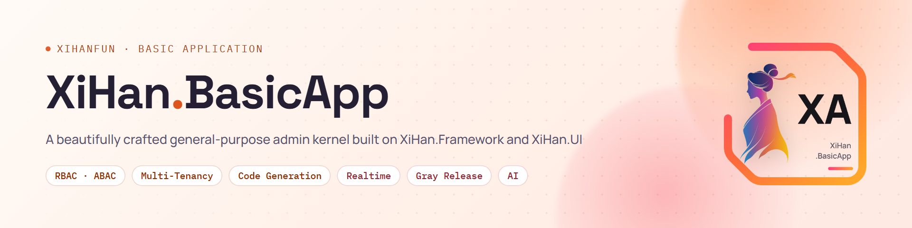
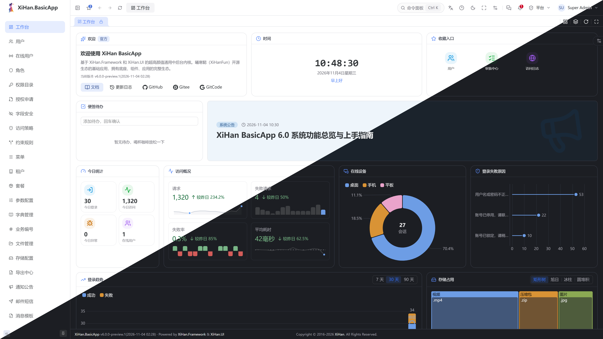
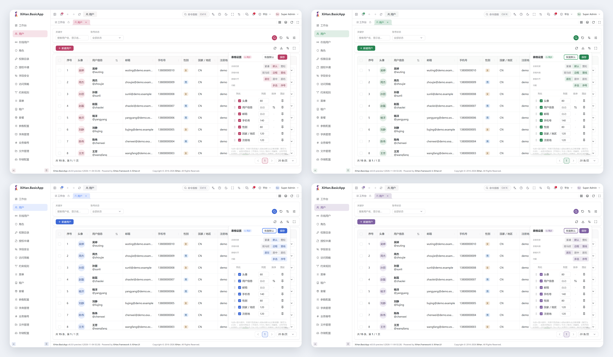
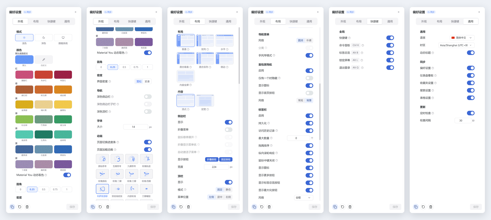
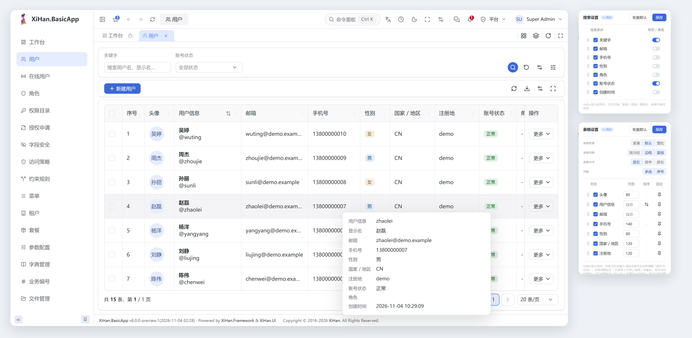
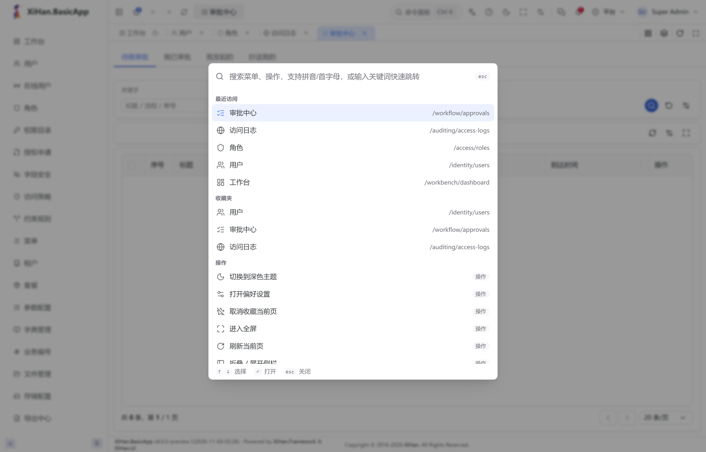
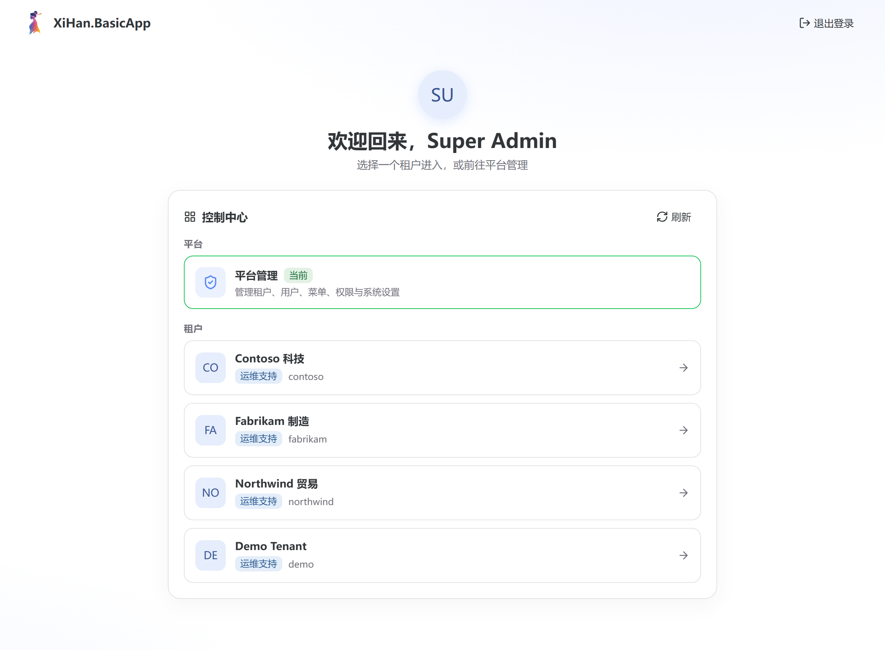

<div align="center">



<h3>An admin kernel with multi-tenancy, fine-grained permissions and auditing out of the box</h3>

<p>
  <a href="https://github.com/XiHanFun/XiHan.BasicApp/actions/workflows/ci.yml"></a>
  <a href="https://github.com/XiHanFun/XiHan.BasicApp/releases"></a>
  
  
  <a href="./LICENSE"></a>
  <a href="https://github.com/XiHanFun/XiHan.BasicApp/stargazers"></a>
  <a href="https://gitee.com/XiHanFun/XiHan.BasicApp"></a>
  <a href="https://gitcode.com/XiHanFun/XiHan.BasicApp"></a>
</p>

<p>
  <a href="https://basicapp.docs.xihanfun.com"><b>Docs</b></a> ·
  <a href="https://basicapp.xihanfun.com"><b>Live Demo</b></a> ·
  <a href="#getting-started"><b>Getting Started</b></a> ·
  <a href="https://basicapp.docs.xihanfun.com/features"><b>Features</b></a> ·
  <a href="https://basicapp.docs.xihanfun.com/changelog"><b>Changelog</b></a>
</p>

<p><b>English</b> | <a href="./README_cn.md">简体中文</a></p>

</div>

XiHan.BasicApp is a general-purpose admin kernel with separate frontend and backend, shipping identity, permissions, tenancy and auditing as a starting point for admin systems. It is the base application of the XiHanFun open-source ecosystem.

## Preview

<table>
  <tr>
    <td align="center" width="33%"><a href="./assets/preview/theme-light-dark.png"></a><br/><b>Light and dark themes</b></td>
    <td align="center" width="33%"><a href="./assets/preview/theme-colors.png"></a><br/><b>Dynamic color</b></td>
    <td align="center" width="33%"><a href="./assets/preview/preference-center.png"></a><br/><b>Preference center</b></td>
  </tr>
  <tr>
    <td align="center" width="33%"><a href="./assets/preview/schema-list.png"></a><br/><b>Schema-driven lists</b></td>
    <td align="center" width="33%"><a href="./assets/preview/command-palette.png"></a><br/><b>Command palette</b></td>
    <td align="center" width="33%"><a href="./assets/preview/control-center.png"></a><br/><b>Multi-tenant control center</b></td>
  </tr>
</table>

## Features

| Area | Capabilities |
| --- | --- |
| Experience | Light and dark themes, Material You dynamic color, synced preferences, schema-driven lists, command palette, split view, small-screen layouts, 7 languages |
| Permissions and security | Server-side permission snapshots, field-level masking, role inheritance with separation of duties, time-limited delegation, guarded impersonation, an OAuth2 / OIDC server |
| Multi-tenancy | Column or per-tenant database isolation, edition gating and quotas, platform-managed operations |
| Auditing and operations | Seven audit logs, end-to-end TraceId, field-level change history, reliable outbox delivery, asynchronous exports |
| Optional modules | Code generation, workflow, print designer, chat and an AI knowledge base, each removable as a unit |
| Engineering | A single source of truth for menus, routes and permission codes, with structural tests guarding the architecture |

See the [feature list](https://basicapp.docs.xihanfun.com/features) for the full set.

## Getting Started

```bash
git clone https://github.com/XiHanFun/XiHan.BasicApp.git
cd XiHan.BasicApp
cp .env.example .env
docker compose up -d
```

The frontend runs at `http://localhost:8080` and the backend at `http://localhost:9708`. The initial account is `superadmin` / `SuperAdmin@123`; change it at first sign-in in production.

Local development needs the .NET 10 SDK, Node.js 24+, pnpm 11+ and PostgreSQL 14+. See the [backend](./backend/README.md) and [frontend](./frontend/README.md) engineering notes.

## Architecture

| Layer | Frontend | Backend |
| --- | --- | --- |
| Application | Pages and entry points | Host and optional modules |
| Kernel | Layouts, routing, requests and state | Identity, permissions, tenancy, auditing and messaging |
| Foundation | [XiHan.UI](https://github.com/XiHanFun/XiHan.UI) | [XiHan.Framework](https://github.com/XiHanFun/XiHan.Framework) |

## Ecosystem

| Project | Description |
| --- | --- |
| [XiHan.Framework](https://github.com/XiHanFun/XiHan.Framework) | A fast, lightweight, efficient, thoughtful .NET framework: microkernel, capability graph, pipeline execution |
| [XiHan.UI](https://github.com/XiHanFun/XiHan.UI) | A fast, lightweight, efficient and thoughtfully built framework-agnostic headless UI component library |

## Documentation

| Destination | Contents |
| --- | --- |
| [Documentation site](https://basicapp.docs.xihanfun.com) | Guides and topic docs |
| [Live demo](https://basicapp.xihanfun.com) | Try it online |
| [Backend notes](./backend/README.md) | Layering, projects and local development |
| [Frontend notes](./frontend/README.md) | Stack, layout and local development |
| [Changelog](https://basicapp.docs.xihanfun.com/changelog) | Release notes and upgrade advisories |

Ask an AI: [Zread](https://zread.ai/XiHanFun/XiHan.BasicApp) · [DeepWiki](https://deepwiki.com/XiHanFun/XiHan.BasicApp)

## Contributing

[Issues](https://github.com/XiHanFun/XiHan.BasicApp/issues) and pull requests are welcome; see the [contributing guide](https://docs.xihanfun.com/cosmos/contributing). Community: QQ group [462371834](https://qm.qq.com/q/qYp1Urv3z2). Support the project: [sponsorship page](https://docs.xihanfun.com/cosmos/sponsor).

## Acknowledgements

| Project | Influence |
| --- | --- |
| [Blog.Core](https://github.com/anjoy8/Blog.Core) | The backend project that started it all, inspiring parts of the architecture and features |
| [VbenAdmin](https://github.com/vbenjs/vue-vben-admin) | The frontend project that started it all, inspiring parts of the architecture and visuals |
| [SoybeanAdmin](https://github.com/soybeanjs/soybean-admin), [LitheAdmin](https://github.com/tenianon/lithe-admin) | Inspiration for parts of the frontend visuals |
| [Admin.Core.ZR](https://gitee.com/izory/ZrAdminNetCore), [YuebonCore](https://gitee.com/yuebon/YuebonNetCore) | Inspiration for parts of the backend features |
| [NaiveUI](https://github.com/tusen-ai/naive-ui) | Early frontend view components |

## License

[MIT](./LICENSE) © 2021-Present XiHanFun and contributors. The XiHan.BasicApp logo, name, interface design and original visual expression belong to the author.
