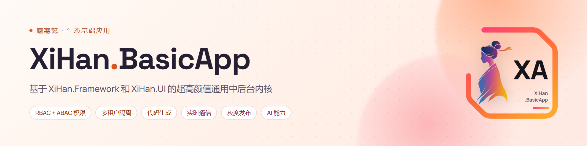
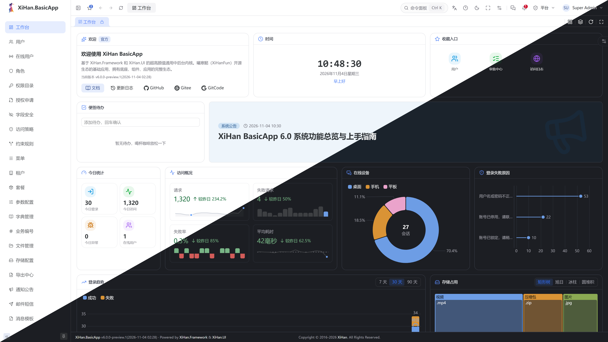
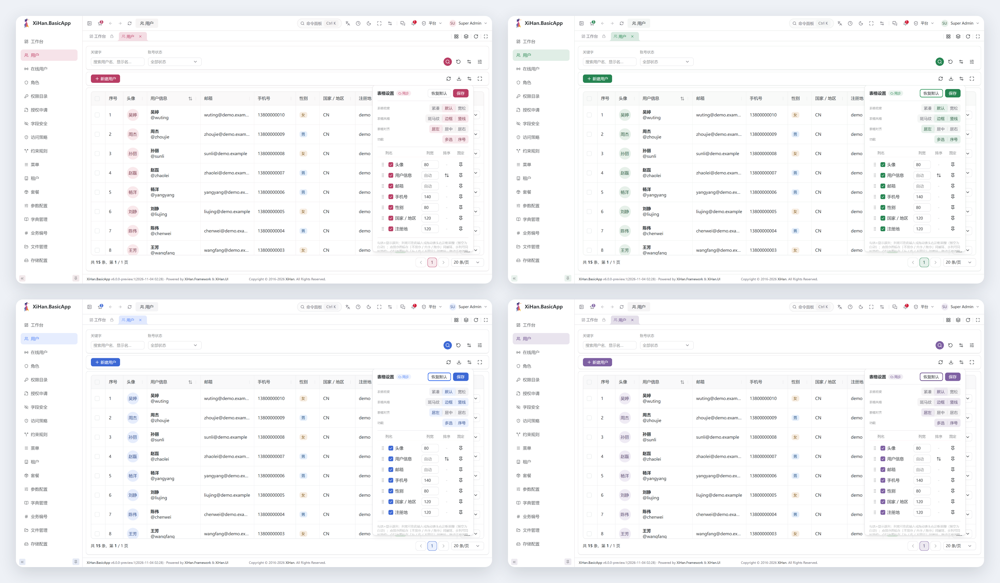
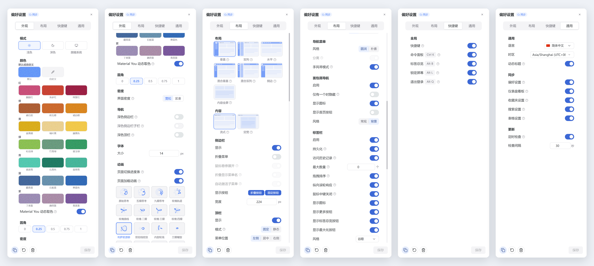
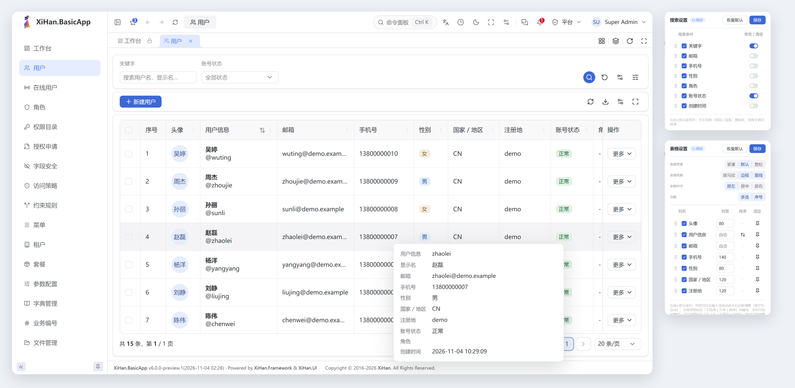
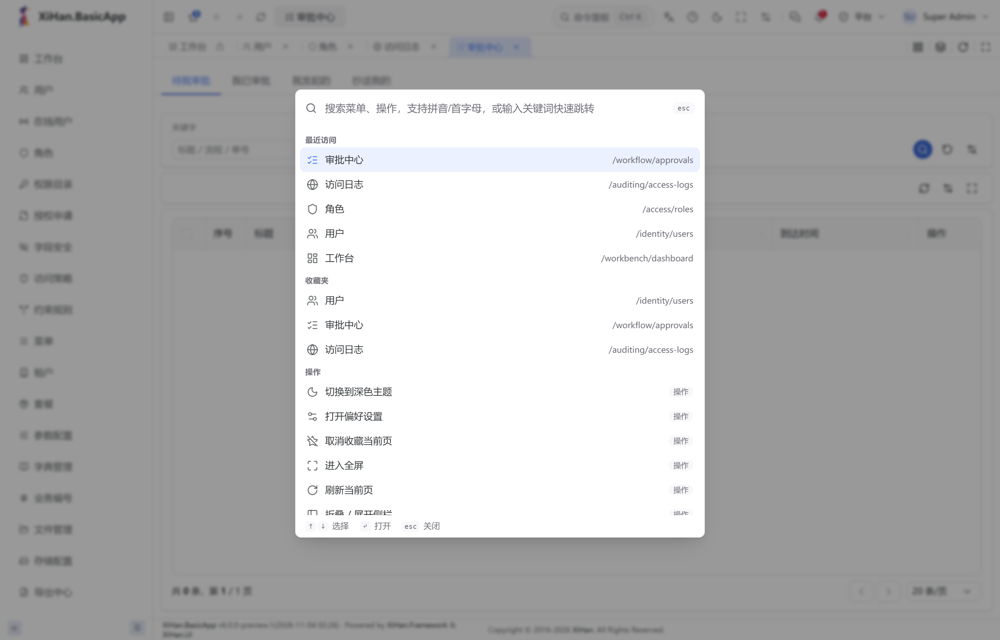
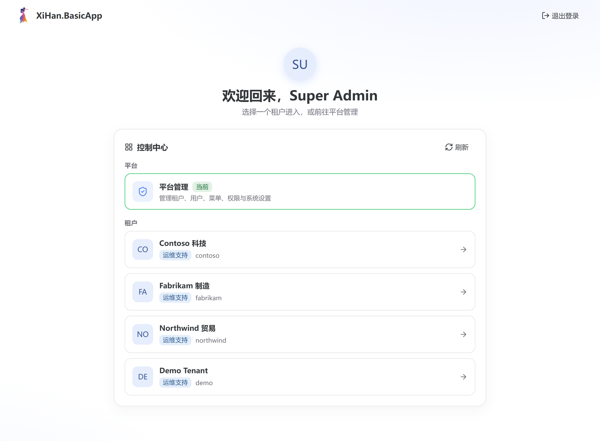

<div align="center">



<h3>多租户、细粒度权限与审计开箱即用的中后台内核</h3>

<p>
  <a href="https://github.com/XiHanFun/XiHan.BasicApp/actions/workflows/ci.yml"></a>
  <a href="https://github.com/XiHanFun/XiHan.BasicApp/releases"></a>
  
  
  <a href="./LICENSE"></a>
  <a href="https://github.com/XiHanFun/XiHan.BasicApp/stargazers"></a>
  <a href="https://gitee.com/XiHanFun/XiHan.BasicApp"></a>
  <a href="https://gitcode.com/XiHanFun/XiHan.BasicApp"></a>
</p>

<p>
  <a href="https://basicapp.docs.xihanfun.com"><b>文档</b></a> ·
  <a href="https://basicapp.xihanfun.com"><b>在线演示</b></a> ·
  <a href="#快速开始"><b>快速开始</b></a> ·
  <a href="https://basicapp.docs.xihanfun.com/features"><b>功能清单</b></a> ·
  <a href="https://basicapp.docs.xihanfun.com/changelog"><b>更新日志</b></a>
</p>

<p><a href="./README.md">English</a> | <b>简体中文</b></p>

</div>

XiHan.BasicApp 是前后端分离的通用中后台内核，内置身份、权限、租户与审计能力，可作为中后台项目的起点，属曦寒懿（XiHanFun）开源生态的基础应用。

## 预览

<table>
  <tr>
    <td align="center" width="33%"><a href="./assets/preview/theme-light-dark.png"></a><br/><b>亮 / 暗双主题</b></td>
    <td align="center" width="33%"><a href="./assets/preview/theme-colors.png"></a><br/><b>动态配色</b></td>
    <td align="center" width="33%"><a href="./assets/preview/preference-center.png"></a><br/><b>偏好中心</b></td>
  </tr>
  <tr>
    <td align="center" width="33%"><a href="./assets/preview/schema-list.png"></a><br/><b>Schema 列表页</b></td>
    <td align="center" width="33%"><a href="./assets/preview/command-palette.png"></a><br/><b>命令面板</b></td>
    <td align="center" width="33%"><a href="./assets/preview/control-center.png"></a><br/><b>多租户控制中心</b></td>
  </tr>
</table>

## 特性

| 领域 | 能力 |
| --- | --- |
| 交互体验 | 亮暗双主题、Material You 动态配色、偏好云同步、Schema 驱动列表页、命令面板、应用内分屏、小屏适配、10 种语言 |
| 权限与安全 | 服务端权限快照、字段级脱敏、角色继承与职责分离、限时委托、受控模拟登录、OAuth2 / OIDC 服务端 |
| 多租户 | 字段或独立数据库隔离、套餐门控与配额、平台代运维 |
| 审计与运维 | 访问、操作、登录、异常、数据与权限变更日志，TraceId 全链路、字段级变更留痕、发件箱可靠投递、异步导出 |
| 可选模块 | 代码生成、工作流、打印设计器、在线聊天、AI 知识库，均可整块卸载 |
| 工程底座 | 业务接口即操作，一份契约同时服务 HTTP、gRPC 与 MCP，前端调用由契约生成；菜单、路由与权限码单一真源，结构性测试约束架构 |

完整能力见[功能清单](https://basicapp.docs.xihanfun.com/features)。

## 快速开始

```bash
git clone https://github.com/XiHanFun/XiHan.BasicApp.git
cd XiHan.BasicApp
cp .env.example .env
docker compose up -d --build
```

首次构建后端镜像时会按锁定的提交克隆 [XiHan.Framework](https://github.com/XiHanFun/XiHan.Framework) 源码，需要能访问 GitHub；启动时先执行表结构升级与种子，再启动后端。前端位于 `http://localhost:8080`，后端接口位于 `http://localhost:9710`。初始账号为 `superadmin`，密码是 `.env` 里的 `SUPERADMIN_PASSWORD`（缺省 `SuperAdmin@123`），首次登录后立即修改。部署前把 `.env` 里的密码与密钥都换成随机值，其余配置见[部署](https://basicapp.docs.xihanfun.com/deployment)。

本机开发需 .NET 10 SDK、Node.js 24+、pnpm 11+、PostgreSQL 14+，并把 XiHan.Framework 检出在同级目录的锁定提交上，步骤见[快速开始](https://basicapp.docs.xihanfun.com/getting-started)与[后端](./backend/README.md)、[前端](./frontend/README.md)工程说明。

## 架构

| 层 | 前端 | 后端 |
| --- | --- | --- |
| 应用层 | 页面与入口 | 启动入口与可选模块 |
| 内核层 | 布局、路由、请求与状态 | 身份、权限、租户、审计与消息 |
| 底座层 | [XiHan.UI](https://github.com/XiHanFun/XiHan.UI) | [XiHan.Framework](https://github.com/XiHanFun/XiHan.Framework) |

## 生态

| 项目 | 说明 |
| --- | --- |
| [XiHan.Framework](https://github.com/XiHanFun/XiHan.Framework) | 快速、轻量、高效、用心的 .NET 开发框架：微内核、能力图谱、管道执行 |
| [XiHan.UI](https://github.com/XiHanFun/XiHan.UI) | 快速、轻量、高效、用心的框架无关 Headless UI 组件库 |

## 文档

| 去处 | 内容 |
| --- | --- |
| [文档站](https://basicapp.docs.xihanfun.com) | 指南与专题文档 |
| [在线演示](https://basicapp.xihanfun.com) | 在线体验 |
| [后端工程说明](./backend/README.md) | 能力包分层、工程清单与本地开发 |
| [前端工程说明](./frontend/README.md) | 技术栈、目录结构与本地开发 |
| [更新日志](https://basicapp.docs.xihanfun.com/changelog) | 版本变更与升级须知 |

AI 问答：[Zread](https://zread.ai/XiHanFun/XiHan.BasicApp) · [DeepWiki](https://deepwiki.com/XiHanFun/XiHan.BasicApp)

## 参与

欢迎提交 [Issue](https://github.com/XiHanFun/XiHan.BasicApp/issues) 与 Pull Request，规范见[贡献指南](https://docs.xihanfun.com/cosmos/contributing)。交流：QQ 群 [462371834](https://qm.qq.com/q/qYp1Urv3z2)。支持项目：[赞助页](https://docs.xihanfun.com/cosmos/sponsor)。

## 致谢

| 项目 | 借鉴 |
| --- | --- |
| [VbenAdmin](https://github.com/vbenjs/vue-vben-admin) | 部分架构与视觉的灵感来源 |
| [SoybeanAdmin](https://github.com/soybeanjs/soybean-admin)、[LitheAdmin](https://github.com/tenianon/lithe-admin) | 部分前端视觉的灵感来源 |
| [Admin.Core.ZR](https://gitee.com/izory/ZrAdminNetCore)、[YuebonCore](https://gitee.com/yuebon/YuebonNetCore) | 部分后端功能的灵感来源 |
| [NaiveUI](https://github.com/tusen-ai/naive-ui) | 早期前端视图组件 |

## 许可证

[MIT](./LICENSE) © 2021-Present XiHanFun and contributors。XiHan.BasicApp 的 Logo、名称、界面视觉设计与原创视觉表达归作者所有。
