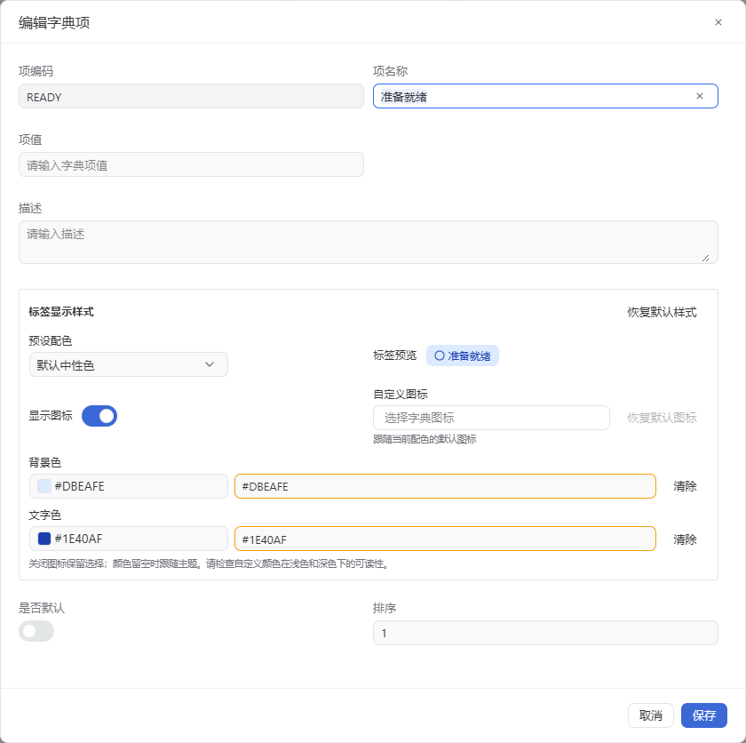
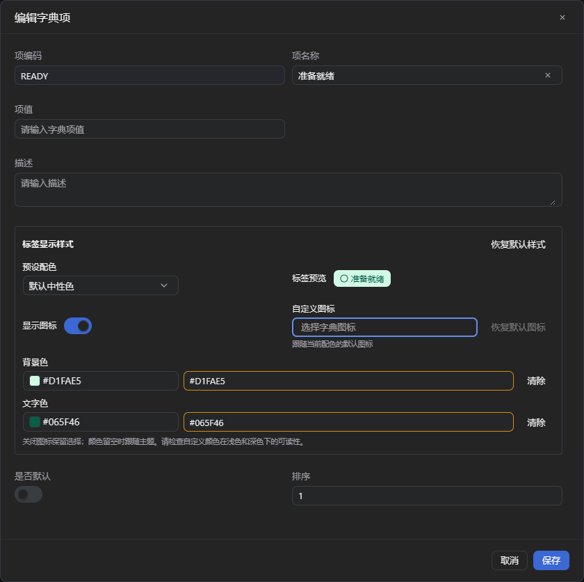
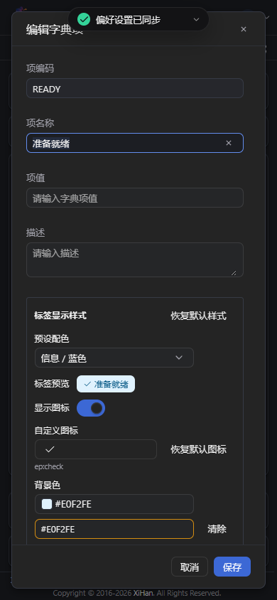

# 字典项标签颜色与图标

字典管理的字典项编辑器支持语义配色、独立背景色与文字色，以及可选的本地图标。取色器和十六进制输入使用同一模型；预览与通用字典标签共用解析和渲染规则。

## 行为

- 配色为 brand、neutral、success、warning、danger、info；未配置样式时为中性标签和圆形装饰图标，保留原名称，未知选项保留原码。
- 自定义颜色仅接受 `#RRGGBB`，保存后规范为大写。背景色和文字色可分别清除，清除的一项跟随预设和主题。
- 图标只能来自本地已安装的七个图标集。隐藏图标保留选择；恢复默认图标只移除图标覆盖；恢复默认样式移除整个 `tagStyle` 节点。
- 图标按需加载后再挂载，切换或卸载会使旧回调失效；加载失败可在下次使用时重试，没有远程图标 URL 或轮询。
- 仅声明 `dictCode` 的通用字段使用字典标签，自定义 `render` 优先级保持不变。导出、报表、业务状态及内置字典管理策略没有变更。

## 数据与兼容

复用 `SysDictItem.Metadata.tagStyle`，**无需数据库结构迁移**。没有新增列、表或种子。

```json
{
  "external": { "id": 9007199254740993 },
  "tagStyle": {
    "tone": "info",
    "backgroundColor": "#E0F2FE",
    "textColor": "#075985",
    "showIcon": false,
    "icon": "ep:check"
  }
}
```

创建和更新 DTO 增加可选 `tagStyle`。省略或 null 不做派生样式合并，旧的完整 Metadata 写入契约继续有效；`{}` 表示清除样式；各属性 null 表示恢复相应默认值。样式更新不提供 Metadata 时，在服务器已有元数据上合并，保留其他节点与 JSON 大整数，不在浏览器中解析后重新序列化整份元数据。

列表/详情增加字符串 `editVersion`，样式更新必须提交 `expectedVersion`；对旧客户端未使用样式字段的请求保留原契约。数据库行版本条件更新拒绝并发覆盖，字典项与父字典缓存版本在原工作单元事务中提交。回退功能代码时可保留 Metadata 节点；旧客户端忽略新增响应字段即可。

TagStyle 写入先遵守 Metadata 字段权限；所有列表、详情、树和选项的派生输出也按 Metadata 来源字段过滤。保留既有租户隔离、操作权限和事务。字典缓存使用父字典版本隔离旧工厂回填，前端使用请求代次拒绝旧响应，并在保存后广播失效给同源标签页。

## 共享组件调整

- `XColorPicker` 的显式 null 传入空受控值，避免清除后内部保留旧颜色；未传值的非受控行为保持不变。
- `IconPicker` 支持 disabled、已有非预载图标回显和加载竞态保护；菜单继续使用原选择流程。
- 通用字典选项仅增加可选的显示字段；非字典字段和自定义渲染没有改动。

## 验证

在独立开发数据库中使用“示例状态 / 准备就绪 / 自定义示例”，没有客户数据。

- 后端 Release 构建成功，4,909 项测试通过。
- 前端 `pnpm check`、`pnpm test`（172 文件、2,626 项）、`pnpm build` 通过；静态检查保留仓库现有的 26 条非阻断警告。
- 真实 API：新增、更新、选项回显、元数据大整数保留、非法颜色/图标拒绝、两请求同版本竞争、清除样式及旧请求兼容。
- 浏览器：新增/编辑、保存后刷新、非预载图标、隐藏/恢复、单独清色、恢复默认、跨标签页通用标签刷新、浅深主题、390px 窄屏、键盘打开与 Esc 返回焦点、保存中禁用，原菜单图标选择器回归。

自定义颜色不会自动改写为其他配色，配置者需要检查浅深主题下的文字对比度。






