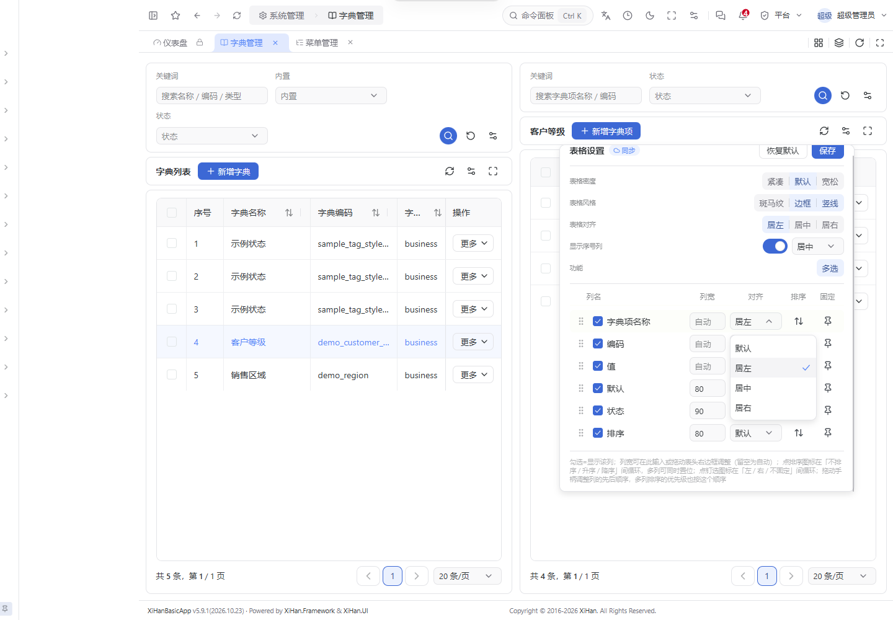
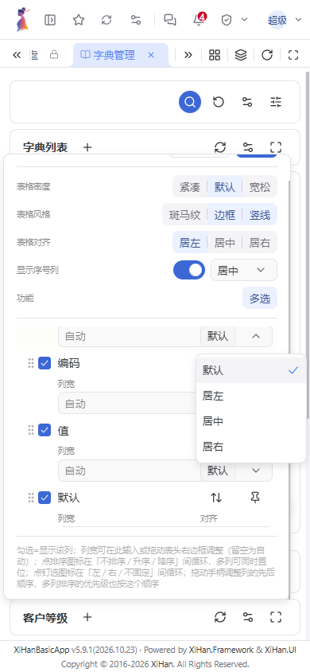

# 表格列对齐与序号显示

在使用 SchemaPage 的页面打开「表格设置」：

- 「显示序号列」默认开启，关闭后隐藏序号，重新开启仍保留之前的序号对齐方向。
- 序号列可独立选择居左、居中或居右，表头和行内序号使用相同方向。
- 每个数据列的「对齐」下拉框支持默认、居左、居中、居右。「默认」随整表对齐变化，显式设置的列不受整表方向影响。
- 勾选列的全选框和行勾选框始终居中，不提供额外配置。
- 调整即时预览，点击「保存」后写入现有本地偏好和用户设置同步服务。「恢复默认」沿用原流程，先恢复草稿，点击保存后才持久化。
- 小屏下列宽和对齐下拉框排到列名下方，避免遮住列名或产生额外横向滚动。

## 兼容与边界

沿用 `showIndex`，增加可选 `indexAlign` 和 `columns[].align`。旧偏好缺少序号对齐时保持居左，缺少单列对齐时跟随整表；已保存的 `showIndex: false` 继续有效。

列设置继续按稳定字段键恢复，隐藏、排序、固定和列宽配置保持原语义。单列隐藏后仍保留对齐；恢复默认会清除覆盖。无后端 API、权限码、依赖或数据库结构变更，**无需数据迁移**。

本功能独立于字典项标签样式，不包含字典编辑、颜色、图标或业务种子的改动。截图使用已有的演示页面展示通用表格功能。

## 验证

基于官方 `dev@d64b24b154b62f2e2dd595afaf104db2516ff8e0` 独立验证：

- `pnpm check` 通过（保留原仓库 26 条非阻断 lint 警告）。
- `pnpm test`：168 个文件、2,620 项测试通过。
- `pnpm build` 通过。
- 浏览器验证单列覆盖、跟随整表、序号显隐、勾选列居中及 390px 窄屏布局；实测表头和行勾选框中心偏移均为 0。
- 单元测试覆盖保存恢复、旧配置、非法方向、隐藏再显示、恢复默认和远端偏好回填。

